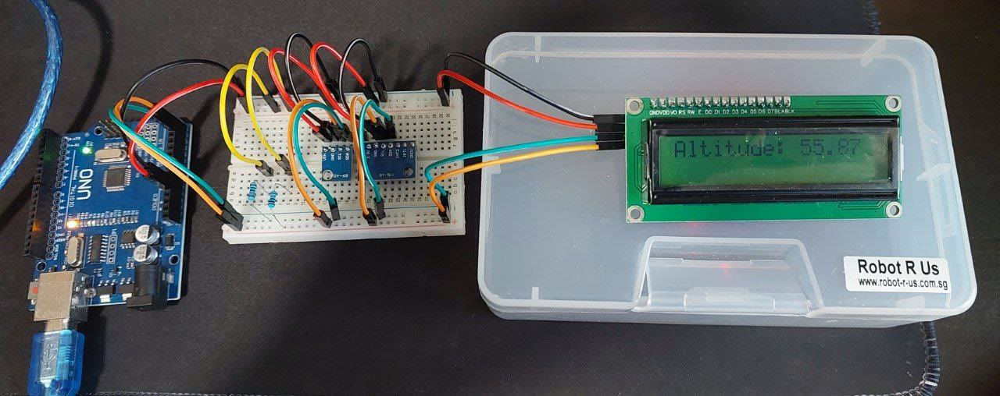

# MAKO Submarine Engineering

**Constrained project · non-game project** · MAKO human-powered submarine team, 2025–2026 · real-time telemetry, computer vision

## Overview

MAKO is Singapore's and Southeast Asia's first human-powered submarine. I was the team's lead developer (submarine) and worked on its mechanical and electrical design. My software contributions were pilot-facing telemetry, published here as a browser dashboard prototype with simulated inputs, and line/gate detection for underwater navigation, which is not published.

## Demonstration

*An early bench prototype of the sensor-to-display path: an Arduino Uno reads two breakout boards on a breadboard, labelled GY-68 and GY-511 (commonly a BMP180 barometric pressure sensor and an LSM303 accelerometer/magnetometer), and shows a live altitude reading on a 16x2 LCD. The sensor set used in the submarine (MPU-9250, MS5837-30BA, RPM sensor) is listed under [My role and contributions](#my-role-and-contributions).*

## My role and contributions

**My work: published prototype**

- Built [SubmarineDashboard](https://github.com/testWhale/SubmarineDashboard), a browser-based telemetry dashboard **prototype** in Python, Flask and Three.js. It shows the submarine's yaw, pitch and roll on a 3D model, with separate IMU and depth panels. In the published code, these values come from **simulated on-screen inputs**; live sensor ingestion is not included.

**My work in the wider MAKO system (not published)**

- Worked on the pilot telemetry GUI used inside the submarine, which translates raw data from a 9-axis IMU (MPU-9250), a depth and pressure sensor (MS5837-30BA) and an RPM sensor into pilot information. The hardware ingestion code is not in a public repository.
- Extended an existing open-source YOLO11 + OpenCV detection pipeline to detect lines, for identifying and navigating through underwater gates, and ran practical tests with it. These modifications are not published; the public fork contains only the upstream author's code.

**Team results** (achieved by the whole MAKO team, not by any single software component)

- 3rd place at **eISR 2026** in Best Run, Best Speed and Best Time.

## Problem

The pilot of a human-powered submarine is underwater and pedalling, with very limited visibility and no outside references. They need to know the vessel's orientation, depth and propulsion speed at a glance, and the course is defined by gates that have to be found and passed through.

## Constraint

- **Physical environment:** the pilot is underwater and fully occupied with propulsion, so information has to be readable instantly.
- **Hardware integration:** data comes from three separate sensors (MPU-9250 IMU, MS5837-30BA depth/pressure, RPM) that have to be turned into usable pilot information.
- **Vision under water:** a general-purpose object detector is not trained to recognise pool lines or race gates.
- **Competition deadline:** the work had to be ready for eISR 2026.

## What I Tested

- **Wider MAKO system (not published):** the telemetry GUI with the MAKO sensor hardware (MPU-9250, MS5837-30BA, RPM sensor), and, in practical sessions, the line/gate detection pipeline.
- **Published prototype:** I ran the dashboard code locally. The Flask server serves the page, the JavaScript and the 3D models, and the standalone CSV utility converts logged time/speed data to JSON.

## What Failed

- **The off-the-shelf detector could not find gates.** The starting pipeline ([yuvarajpanditrathod/Real-Time-Object-Detection-using-YOLO11](https://github.com/yuvarajpanditrathod/Real-Time-Object-Detection-using-YOLO11)) uses pretrained YOLO11 models for general object detection. Those models have no class for pool lines or gates.
- **The published dashboard prototype is not a complete telemetry system.** Its inputs are simulated on-screen controls. A placeholder car model stands in for the submarine, because the submarine model is in USDZ format, which the Three.js GLTFLoader cannot load.

## What I Changed

- Extended the detection pipeline to detect **lines**, so the submarine could identify and navigate through gates. These changes are not published, and no accuracy or speed figures are claimed.
- Built the dashboard prototype around separate IMU and depth panels, and a 3D model whose rotation follows yaw, pitch and roll (applied in YXZ order).
- Listed the prototype's limitations openly in its README: simulated inputs, a placeholder model, a static connection label, no dedicated depth readout, no RPM panel, a standalone CSV utility, and a development-only server configuration.

## What Happened

- The MAKO team placed **3rd at eISR 2026** in Best Run, Best Speed and Best Time. This is a whole-team result.
- The dashboard prototype is public with verified setup instructions: [testWhale/SubmarineDashboard](https://github.com/testWhale/SubmarineDashboard).
- The upstream detection project is kept as a credited **research reference** ([testWhale/Real-Time-Object-Detection-using-YOLO11](https://github.com/testWhale/Real-Time-Object-Detection-using-YOLO11)). It contains no code of mine.

## Technologies

Python, Flask, JavaScript, Three.js, lil-gui, glTF, Ultralytics YOLO11, OpenCV, PyTorch, MPU-9250, MS5837-30BA, RPM sensor

## Supporting evidence

- Photo of the sensor bench prototype (see [Demonstration](#demonstration))
- [SubmarineDashboard repository](https://github.com/testWhale/SubmarineDashboard): source, architecture, setup verification and known limitations
- [YOLO11 upstream fork](https://github.com/testWhale/Real-Time-Object-Detection-using-YOLO11): research reference only, with the upstream author's code and attribution and none of my modifications

## Source availability

| Component | Availability |
|---|---|
| Telemetry dashboard prototype (simulated inputs) | Public, [testWhale/SubmarineDashboard](https://github.com/testWhale/SubmarineDashboard) |
| Line/gate-detection modifications | Not published; the public fork is the upstream project only |
| Sensor ingestion / firmware | Not published |

[← Back to portfolio](../README.md)
