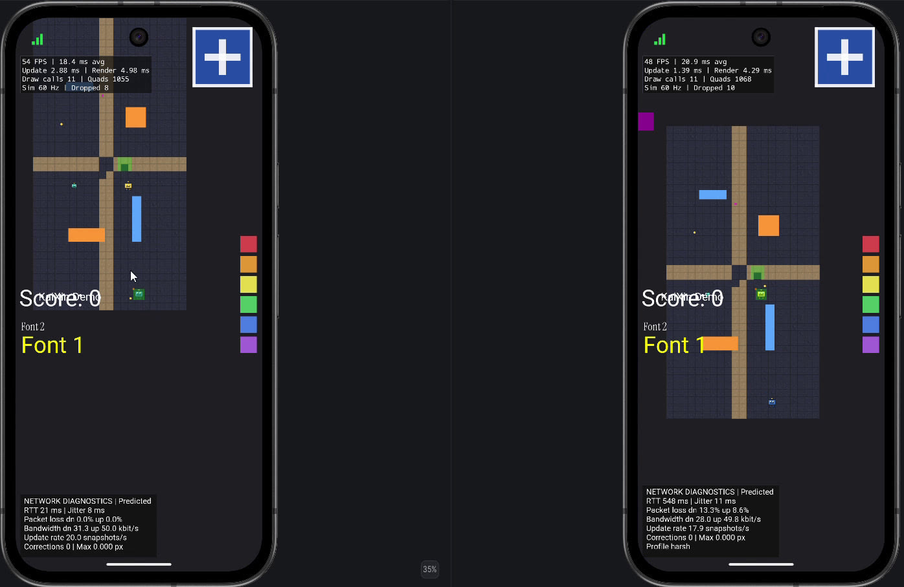

# Multiplayer Networking & Server Infrastructure

**Flagship project** · DigiPen studio project (Team 25), 2026 · C++, networking, Linux

> The original source code is restricted from public distribution under institutional requirements. This case study presents only authorised project descriptions and demonstration evidence.

## Overview

As part of a DigiPen studio team, I built a custom cross-platform C++ engine targeting Windows and Android, with server-authoritative multiplayer for up to four players and a dedicated server deployed on Linux. My focus was the networking layer and the tooling to prove that it held up under bad network conditions.

## Demonstration

*Same build, two network profiles. Left: normal (RTT 21 ms, 0% packet loss, 20.0 snapshots/s). Right: harsh (RTT 548 ms, 13.3% down / 8.6% up packet loss, 17.9 snapshots/s). Reconciliation corrections are 0 in both.*

### Normal network profile

https://github.com/user-attachments/assets/c882fcf0-1840-400a-bcf7-0f790ab21c82

### Harsh network profile

https://github.com/user-attachments/assets/2824216c-0e8a-4e37-9386-836244f38857

### Dedicated server diagnostics with a connected client

https://github.com/user-attachments/assets/32d81771-acf9-46d1-889a-ba7bd23b4079

*The server diagnostics view shows the live process, workload counters and memory-safety checks (ASan / UBSan / LSan) alongside a connected client. Server port and host details are redacted.*

### Client-side prediction

https://github.com/user-attachments/assets/7ca2e993-24b4-4080-b733-42666b6ba95b

## My role and contributions

- Technical leadership on the networking and server side of the engine
- Server-authoritative systems built on the engine's modular ECS, so that every client sees consistent game state
- Real-time snapshot synchronisation for player actions, projectiles and gameplay events
- Client-side prediction with server reconciliation for the local player, and interpolation for remote entities
- An in-engine network diagnostics HUD and logging pipeline: RTT, jitter, packet loss, up/down bandwidth, snapshots per second, reconciliation corrections and interpolation underruns
- Seven simulated network profiles for stress testing
- Automated tests to catch networking regressions, plus memory-safety validation
- A dedicated server build deployed on Linux and run as a systemd service

## Problem

A real-time multiplayer game has to feel instant for the local player, while one authority (the server) decides what actually happened. Otherwise four clients drift apart, or cheat. The engine had to support up to four players on Windows and Android, connected over real networks with variable latency and packet loss.

## Constraint

- **Server authority:** clients cannot simply trust their own state, so every local action waits on a round trip unless it is predicted.
- **Real networks are bad networks:** the game had to stay playable on links from broadband down to high-latency, lossy mobile connections.
- **Cross-platform:** the same engine and netcode had to run on Windows and Android clients and on a headless Linux server.
- **Restricted source:** the team repository is institutionally restricted, so this case study rests only on authorised public evidence.

## What I Tested

- Gameplay across **seven simulated network impairment profiles**, from broadband and 4G to harsh high-latency conditions of up to **250 ms one-way latency with 10% packet loss**.
- Live network behaviour, using the diagnostics HUD. In a recorded session on a normal connection, the HUD showed RTT of roughly 18–44 ms, 3–14 ms jitter, 0% packet loss, about 30 kbit/s down and 50 kbit/s up, and about 19–20 snapshots per second, with the client simulating at 60 Hz.
- Automated tests for networking regressions, and memory-safety validation. In the recorded live server session, the AddressSanitizer, UndefinedBehaviorSanitizer and LeakSanitizer report counts were all 0 ("No sanitizer errors observed") while a client was connected and enemies and projectiles were active.
- Dedicated server builds running on Linux, for cross-platform validation.

## What Failed

During multiplayer development, introducing a Dash spell exposed an inconsistency between client-side prediction and authoritative server simulation.

The local client applied the spell's movement immediately, but the server did not initially account for the corresponding movement. When the next authoritative state arrived, reconciliation corrected the player's position towards the previous server position, causing visible rubber-banding.

This exposed a limitation in predicting gameplay actions beyond standard movement inputs: both the client and server must account for spell-induced movement consistently.

## What I Changed

- Added **client-side prediction**, so the local player's movement applies immediately instead of waiting for the server.
- Added **server reconciliation**: when an authoritative snapshot arrives, the client corrects its predicted state, which keeps the server as the source of truth.
- Added **remote entity interpolation**, so other players move smoothly between the snapshots that do arrive.
- Built the **diagnostics HUD and logging**, so corrections, underruns and bandwidth are visible during play rather than guessed at.

## What Happened

- **Up to 4 concurrent players** supported by a server-authoritative model.
- Validated across **7 simulated network profiles**.
- At roughly **548 ms RTT** under the harsh profile, local movement stayed predicted and stable while syncing at about **18 snapshots per second**.
- A dedicated server build runs on **Linux** under **systemd**.

These results come from **simulated** network impairment in a studio project. They are not production-scale load testing.

## Technologies

C++, custom ECS engine, client–server networking, client-side prediction, server reconciliation, entity interpolation, Linux, systemd, automated testing, Windows, Android

## Supporting evidence

- Screenshot and screen recordings of the network diagnostics HUD and dedicated server (see [Demonstration](#demonstration))
- Public demonstration and technical write-up: [LinkedIn post: C++ Multiplayer Engine | Networking & Server Infrastructure](https://www.linkedin.com/feed/update/urn:li:activity:7531700571842613249/)

## Source availability

The original team repository (`DigiPen-SG-Year-2/2026-team-25`) is **private** and restricted from public distribution. No source code, server addresses, credentials, infrastructure configuration or team-owned assets are published here.

[← Back to portfolio](../README.md)
